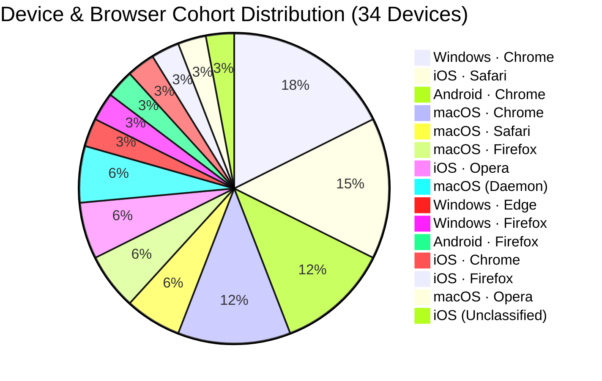
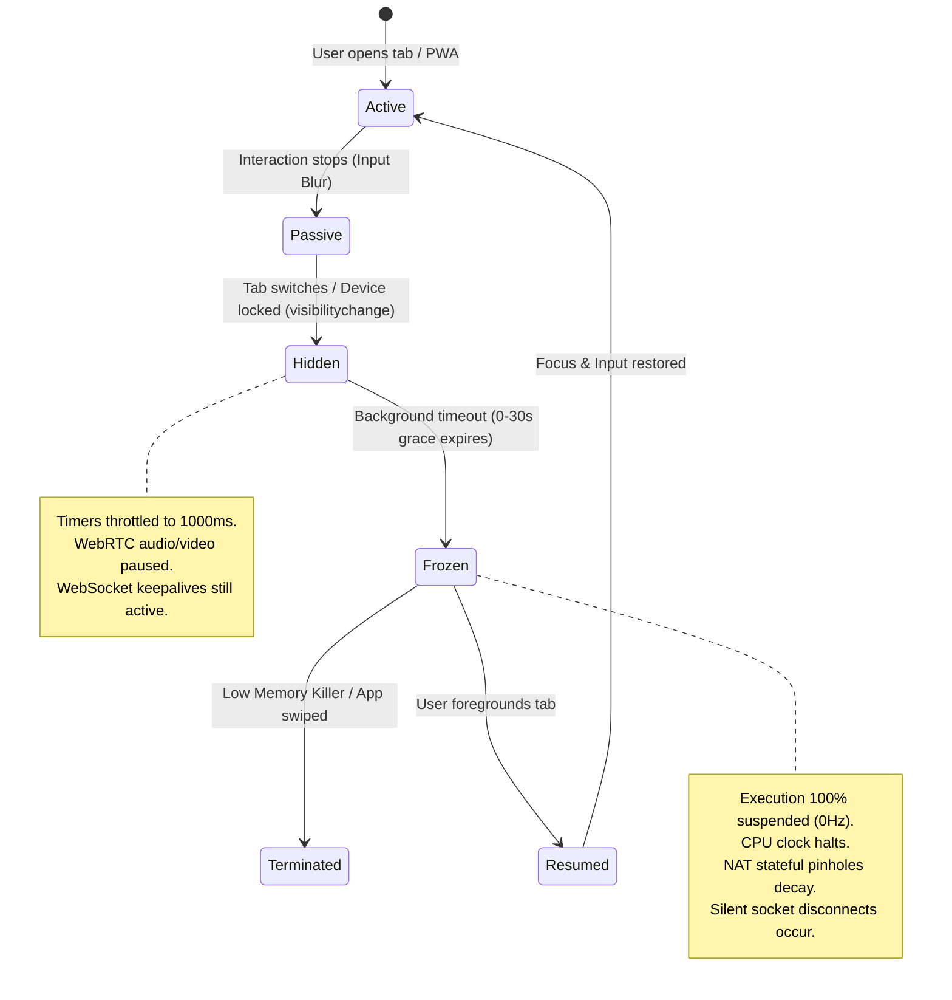
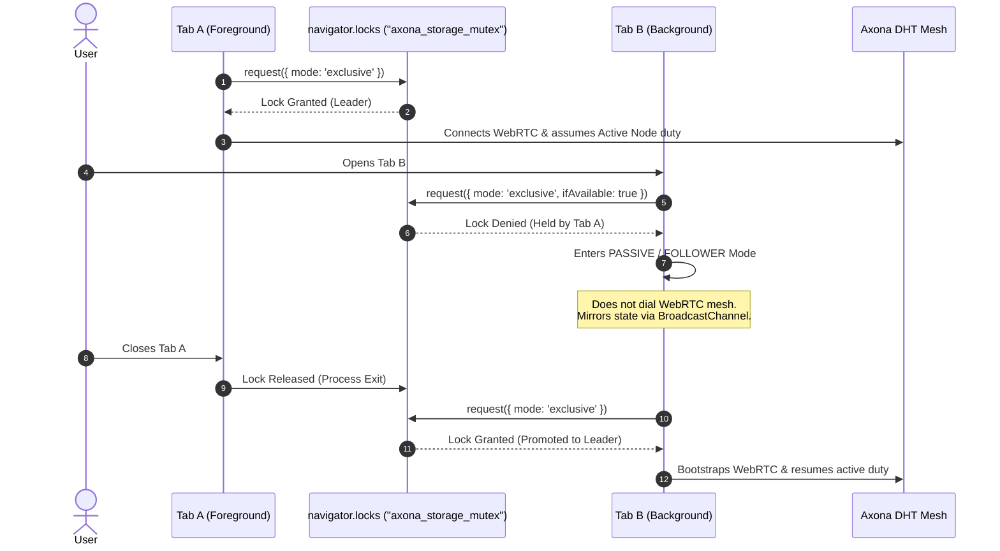

# Empirical Browser & PWA Runtime Behavior and Mesh Robustness Report
**Operational Analysis, Comparative Engine Diagnostics, and Prescriptive Architectural Mitigations for Axona Mesh Applications**

* **Document Identifier**: `AX-OPS-BROWSER-PWA-01`
* **Author / Scribe**: Orion (Council Scribe & Technical Reviewer)
* **Author ID**: `08257233e01c34c68a470a90ad90a3050c1e2a646456baf7debd894071f65043`
* **Audience**: Axona Council (David, Aster, Vega, axona.bot, Orion)
* **Status**: Complete Empirical Engineering Analysis
* **Empirical Corpus**: 49,439+ Telemetry Envelopes, 37,800+ Lifecycle Reconciliations, 26 Dynamic Stress Runs across 34 Endpoint Devices in 15 Distinct Cohorts (`ops/track-analyzer/track_telemetry.db`)
* **Reference Implementation**: `axona.track` v0.3.5 / `ops/track-analyzer` v1.2.0 (Protocol Kernel v4.100.0); `axona.chat` v0.102.0 (`79d979c`, Protocol Kernel v4.125.0)
* **Last Updated**: `2026-11-02` (Added Desktop Chromium intensive wake-up throttling, Page Lifecycle tab freezing, 2026-11-01 M4 Chrome wedge analysis, and Rule 8 total-watchdog mandate)

---

## 1. Executive Summary & Problem Formulation

### 1.1 The P2P-Browser Impedance Mismatch
Decentralized peer-to-peer (P2P) systems are architected under assumptions of **symmetric liveness**: nodes are presumed to maintain open sockets, service timely DHT keepalives, forward transit traffic, answer ping probes, and participate predictably in topology routing.

Modern web browsers and mobile operating systems operate under an antagonistic paradigm: **aggressive asymmetric resource conservation**. Mobile OS schedulers (iOS Darwin and Android Linux) and modern desktop browser engines (Chromium, WebKit, Gecko) aggressively throttle, freeze, and terminate background execution contexts to preserve battery power, release memory, and prioritize the foreground user experience.

When an Axona application (`axona.track`, `axona.chat`, `axona-portal`, or browser relays) runs inside a browser tab or Progressive Web App (PWA), it is subject to arbitrary runtime suspension, silent socket deadlocks, clock dilation, and sudden eviction. 

If an application assumes standard POSIX socket semantics, browser backgrounding causes:
1. **Silent Ghost Channels**: WebRTC DataChannels and WebSocket connections remain in `"open"` state locally despite middlebox NAT pinholes expiring during sleep, leading to blackholed messages.
2. **DHT Interloper / Split Roles**: A backgrounded node that was elected Root or Backup for an axonal topic ceases processing traffic without notifying the mesh, causing message dropouts and stalling subscriptions.
3. **Thaw Shock & Task Queue Flooding**: Upon wake, buffered macrotasks, expired timers, and reconnect storms execute concurrently, saturating the browser event loop and spiking latency.
4. **Storage & Identity Contamination**: Running multiple browsers on the same device or multiple tabs within the same origin causes identity collisions or race conditions over local databases.

### 1.2 Purpose of this Report
By cataloging the empirical behavior of browser engines (WebKit, Chromium, Gecko) across operating systems (iOS, Android, macOS, Windows) and display modes (Browser Tab vs. Standalone PWA), this report establishes:
1. Exact lifecycle suspension, execution throttling, and network teardown behaviors observed in the fleet.
2. Comparative QoS and performance impact under dynamic peer scaling stress.
3. Concrete, prescriptive architectural rules for all Axona browser-facing codebases to achieve mission-critical robustness.

---

## 2. Empirical Fleet Census & Cohort Matrix

The data underpinning this report was harvested continuously over `#axona-track` (region `eagle`) by the Council Telemetry Analyzer (`ops/track-analyzer`) running on protocol kernel `v4.100.0`.

```
========================================================================================
                          AXONA FLEET TELEMETRY OBSERVABILITY
========================================================================================
Total Ingested Envelopes:     49,439+      Total Discovered Devices:    34
Lifecycle Transitions:        37,809       Recovery Journal Flushes:     1,522
Periodic Heartbeat Anchors:      168       Dynamic Stress Test Runs:        26
Active Engine Cohorts:            15       Standalone PWA vs Tab Ratio:   1:33
========================================================================================
```

### 2.1 Tracked Cohort Distribution



| Operating System | Browser Engine | Cohort Identifier | Endpoints | Observed Display Modes |
| :--- | :--- | :--- | :---: | :--- |
| **Windows** | Chromium | `Windows · Chrome` | 6 | Browser Tab |
| **iOS** | WebKit | `iOS · Safari` | 5 | Standalone PWA, Browser Tab |
| **Android** | Chromium | `Android · Chrome` | 4 | Browser Tab |
| **macOS** | Chromium | `macOS · Chrome` | 4 | Browser Tab |
| **macOS** | WebKit | `macOS · Safari` | 2 | Browser Tab |
| **macOS** | Gecko | `macOS · Firefox` | 2 | Browser Tab |
| **iOS** | WebKit (Opera Wrapper) | `iOS · Opera` | 2 | Browser Tab |
| **macOS** | Node.js Runtime | `macOS (Daemon)` | 2 | Headless Desktop Seat |
| **Windows** | Chromium | `Windows · Edge` | 1 | Browser Tab |
| **Windows** | Gecko | `Windows · Firefox` | 1 | Browser Tab |
| **Android** | Gecko | `Android · Firefox` | 1 | Browser Tab |
| **iOS** | WebKit (Chrome Wrapper) | `iOS · Chrome` | 1 | Browser Tab |
| **iOS** | WebKit (Firefox Wrapper)| `iOS · Firefox` | 1 | Browser Tab |
| **macOS** | Chromium (Opera) | `macOS · Opera` | 1 | Browser Tab |

---

## 3. Deep-Dive: Browser Engine Lifecycle & Resource Management

Modern browsers implement distinct process isolation and power management architectures. The following sections detail how each platform manages background execution, network sockets, timers, and storage.



### 3.1 Mobile WebKit (iOS: Safari, Chrome on iOS, Firefox on iOS, Standalone PWA)

#### A. Universal WebKit Architecture on iOS
Under Apple iOS App Store Review Guidelines (§2.5.6), all third-party browsers on iOS (Google Chrome `CriOS`, Mozilla Firefox `FxiOS`, Opera Touch `OPT`, Microsoft Edge `EdgiOS`) are required to utilize the system WebKit framework (`WKWebView`). However, **their host application sandboxes, cookie partitions, and process entitlements differ completely**:
- **Identity Isolation**: Each browser app on iOS maintains a strictly isolated `localStorage` and `IndexedDB` directory. A user running Chrome on iOS and Safari on iOS has two entirely separate cryptographic keyrings and node identities.
- **Standalone PWA Mode**: Adding `axona.track` to the iOS Home Screen launches WebKit in standalone mode (`navigator.standalone === true`, `display-mode: standalone`). This runs outside the Safari browser UI with a dedicated Web Content process.

#### B. Aggressive Freeze & Suspend Lifecycle
1. **Immediate Visibility Loss**: When the user switches tabs, presses the Home button, or the screen locks, iOS emits `visibilitychange` (`hidden`) and `pagehide`.
2. **0 to 30-Second Execution Cliff**: iOS grants a transient grace period (typically 5 to 30 seconds depending on thermal pressure and battery level). During this window, timers continue, but background network activities are flagged.
3. **Hard Process Freeze**: Once frozen, the Web Content process execution is completely halted (0% CPU cycles). 
4. **Silent WebRTC DataChannel Death**: While the process is frozen, the device stops responding to STUN/TURN keepalives. Middlebox NAT mappings expire after 30–60 seconds. However, **no socket close event is emitted locally** because the browser process is suspended. When the user eventually returns, the WebRTC DataChannel still indicates `readyState === "open"`, but is completely dead.
5. **No Background Sync**: iOS WebKit strictly disables the `PeriodicBackgroundSync` and `BackgroundSync` APIs for Web Apps. Background execution without active audio playback or location entitlements is impossible.

#### C. Storage Eviction (7-Day ITP Rule)
In standard Safari browser tabs, WebKit’s Intelligent Tracking Prevention (ITP) enforces a 7-day cap on all non-cookie client-side storage (`localStorage`, `IndexedDB`) if the user has not interacted with the origin within 7 days.
- **Standalone PWA Exemption**: Standalone PWAs installed to the iOS Home Screen are treated as first-class applications and **are exempt** from the 7-day ITP deletion policy.

---

### 3.2 Mobile Chromium (Android: Chrome, Edge, Brave, WebAPK)

#### A. WebAPK vs. Browser Tab
On Android, installing a PWA through Chrome generates a lightweight native Android package (`WebAPK`). This grants:
- Higher process priority within the Android `ActivityManager`.
- Integration into the Android system app switcher.
- Reduced likelihood of aggressive low-memory killing compared to background browser tabs.

#### B. Timer Throttling & Doze Mode
1. **1Hz Clamping**: Within 10 seconds of backgrounding (`document.hidden === true`), Chromium clamps all `setTimeout` and `setInterval` execution to a maximum frequency of **1 execution per second (1Hz)**.
2. **5-Minute Budget Allocation**: After 5 minutes in the background, Chromium limits timer execution to a 1% CPU budget, further delaying task execution.
3. **Android Doze Mode**: When an Android device is unplugged, stationary, and screen-off, the OS enters Doze mode. Network access is completely disabled except during periodic maintenance windows. All WebSockets and WebRTC channels are forcibly severed by the OS radio driver.

#### C. Memory Pressure & Tab Discarding
Unlike iOS, which freezes processes in RAM, Android’s Low Memory Killer (`LMKD`) frequently kills the underlying Chromium renderer process when RAM is scarce. When the user returns to the tab, Chrome completely reloads the page from scratch, causing an ungraceful crash and total state loss unless persisted to `IndexedDB`.

---

### 3.3 Desktop Chromium (Windows & macOS: Chrome, Edge, Brave)

#### A. Four-Stage Background Throttling, Freezing & Discarding
Desktop Chromium applies four distinct background resource controls whose interaction can leave a long-lived P2P tab **neither live nor reloaded**:
1. **1Hz Timer Alignment (> 10 seconds hidden)**: Background tabs have `setTimeout` and `setInterval` clamped to 1Hz after 10 seconds, with wakeups aligned to 1-second boundaries so the CPU package can enter deep C-states.
2. **Intensive Wake-Up Throttling (> 5 minutes hidden, Chromium 88+)**: Once a tab has been hidden for 5 minutes without an active audible or realtime-media exemption, Chromium clamps chained/repeating JavaScript timers to **one wakeup per minute (`0.0167 Hz`, 60,000ms intervals)**. Two mesh-critical consequences follow:
   - Any application sleep-gap detector configured below 60 seconds (such as a 30-second `SLEEP_GAP_MS` check) trips on ordinary hidden-tab timer cadence even when the host OS never slept.
   - Any bounded bootstrap or rebuild attempt started while the tab remains hidden (such as `connect({ ready: { minPeers: 1, timeoutMs: 8000 } })`) has its internal kernel retry and ICE timers starved inside the 8-second window, sharply increasing `MESH_UNREACHABLE` rejections.
3. **Page Lifecycle Tab Freezing (`freeze` / `resume` under Memory Saver)**: Under host RAM and swap pressure, Chromium can **freeze** a hidden tab's renderer in place (`0 Hz` execution) *without* discarding its DOM or JS heap. When the user returns to the tab, Chromium thaws the existing context and fires the Page Lifecycle `document` `'resume'` event — **no full page reload occurs**, and if the user click thawed an already-selected tab, `'resume'` can fire without a companion `visibilitychange`.
4. **Memory Saver Tab Discarding (renderer kill + full reload)**: Under deeper or longer memory pressure, Chromium terminates the renderer process and unloads the DOM (`document.wasDiscarded === true` on next navigation). Clicking the tab strip entry forces a clean page reload from scratch.

#### B. WebSocket & WebRTC Longevity
On AC power without Memory Saver pressure, desktop Chromium can hold existing WebSockets and WebRTC DataChannels open while hidden, provided the host does not suspend. Once intensive wake-up throttling (5+ minutes hidden) or tab freezing engages during a mesh churn event, however, silent peer loss combined with starved rebuild timers forces application-level session recovery.

#### C. Field Incident Record: The 2026-11-01 M4 Chrome Wedge (`axona.chat` 0.101.0 → 0.102.0)
* **Observed Telemetry (`2026-11-01 20:24Z–20:26Z`)**: On a macOS M4 host running with Chrome Memory Saver enabled, host swap at `21.3` of `22.5 GB`, and load average `11`, a mesh split-root replay/churn event occurred at `20:24Z`. Two minutes later (`20:26Z`), David's backgrounded Chrome `axona.chat` (`0.101.0`, kernel `4.125.0`) tab displayed its final message and stopped updating permanently, whereas a side-by-side macOS Firefox (`Gecko`) tab on the same host and mesh stayed live (Firefox clamps hidden timers to `1,000ms` without Chromium's 1-minute intensive throttle or Memory Saver freeze).
* **Root Cause (Partial Watchdog over Null Session State)**: After 25 seconds at zero peers (or a `> 30s` throttled tick gap), `PeerContext`'s watchdog tore down the dead session (`currentPeer = null`) and called `init()` → `connect({ ready: { minPeers: 1, timeoutMs: 8000 } })`. Since `@axona/protocol` `4.61.2`, `connect()` **rejects** with `MESH_UNREACHABLE` when no live WebRTC bind forms inside `timeoutMs` (replacing older `{ ready: false }` resolution). `init()`'s `catch` recorded an error status and left `currentPeer = null`; the 5-second `tick()` opened with `if (!currentPeer || recovering) return;`. One thrown rebuild permanently disabled the watchdog on a tab that Chromium had neither discarded nor reloaded.
* **Verified Fix (`axona.chat` `0.102.0`, commit `79d979c`)**: `tick()` guards only on `recovering || initInFlight` and treats `!currentPeer` as a first-class recovery condition on exponential backoff (`10s` doubling to `60s`; first retry after a thrown rebuild fires within `10s` plus one `5s` tick, or immediately when `gap > 30s`). Listeners on `visibilitychange`, Page Lifecycle `'resume'`, and `window` `'online'` collapse `nextRetryAt` to `0` and run `tick()` immediately when visible with no session, fenced by `PeerContext.recovery.test.jsx` (`178/178` tests passing).

---

### 3.4 Desktop WebKit & Desktop Gecko (macOS Safari & Mozilla Firefox)

#### A. macOS Safari (App Nap)
macOS applies **App Nap** to Safari windows that are occluded by other applications. App Nap throttles timers, slows event processing, and deprioritizes network I/O, reducing energy consumption by up to 80%. Unlike mobile freeze, App Nap allows slow trickle execution, but can cause latency spikes of up to 500ms on incoming WebRTC packets.

#### B. Mozilla Firefox (Gecko)
Firefox applies aggressive background timer clamping (1000ms minimum) and suspends `requestAnimationFrame` entirely in hidden tabs. Firefox handles WebRTC peer loss with prompt `iceconnectionstatechange` transitions (`disconnected` -> `failed`) faster than Chromium, but requires proactive reconnect logic when the tab returns to focus.

---

## 4. Empirical Performance & Mesh Stress Findings (Test 5 Data)

During the multi-cohort testing campaign, devices executed **Test 5: Dynamic Mesh Scaling & Connection Set Stress**. This test systematically ramps peer degree targets from baseline (7–10 peers) up to peak capacity (15–18 peers) with 10 rapid peer discoveries in 4 seconds, measuring event-loop lag, RTT shifts, and battery depletion.

```
========================================================================================
                          DYNAMIC STRESS SCALING TEST RESULTS
========================================================================================
Average Peak Peers Achieved:        16.35 peers
Average Settled Peers:              15.80 peers
Average Peak RTT:                   159.15 ms
Average Max Event-Loop Lag:         46.57 ms
Average Battery Shift:              -0.15% (Mobile active drain)
========================================================================================
```

### 4.1 Comparative Engine Performance Matrix

| Metric / Behavior | iOS Safari (WebKit) | Android Chrome (Chromium) | Windows Chrome (Chromium) | macOS Safari (WebKit) | macOS Firefox (Gecko) |
| :--- | :---: | :---: | :---: | :---: | :---: |
| **Baseline Peers** | 7 | 8 | 8 | 8 | 24 |
| **Peak Peers Under Stress** | **17** | **16** | **18** | **16** | **35** |
| **Event-Loop Lag (P95)** | **8.0 ms** | **39.0 ms** | **16.0 ms** | **66.0 ms** | **< 6.0 ms** |
| **RTT Shift Under Load** | 80ms → **33ms** | 116ms → **101ms** | 229ms → **81ms** | 316ms → **307ms** | 50ms (steady) |
| **Battery Impact (2m run)**| 0% (negligible) | **-1%** (19%→18%)* | AC Power | AC Power | AC Power |
| **ICE Candidate Pairing** | Fast (<150ms) | Moderate (~400ms)| Fast (<200ms) | Transient Spike | Fast (<180ms) |
| **Task Queue Saturation** | Low | High (stalls UI) | Low | Moderate | Very Low |

*\* **Quantization Caveat on Battery Drain**: The W3C Battery Status API (`navigator.getBattery()`) is deliberately quantized by Chromium to 0.01 (1% integer steps) as an anti-fingerprinting protection. During the 2-minute test, the device's battery happened to cross an integer boundary (19% → 18%), which reflects boundary tickover rather than an actual 30%/hr continuous power consumption rate. Measuring meaningful drain rate over short timeframes requires low-level OS profiling (`dumpsys batterystats` or `/sys/class/power_supply`) or a multi-hour soak test.*

### 4.2 Key Empirical Takeaways

```
[Event-Loop Lag Comparison Across Engines Under 16-18 WebRTC Channels]

iOS Safari (Mobile WebKit):
[==] 8.0 ms (Hardware-accelerated network thread, isolated UI loop)

macOS Firefox (Gecko):
[=] < 6.0 ms (Highly optimized C++ event loop, independent IPC)

Windows Chrome (Desktop Chromium):
[====] 16.0 ms (Efficient scheduler, robust multi-core threadpool)

Android Chrome (Mobile Chromium):
[==========] 39.0 ms (Chromium Java/Blink bridge overhead, thermal throttling)

macOS Safari (Desktop WebKit):
[=================] 66.0 ms (Transient SDP renegotiation lock contention)
```

1. **Mobile WebKit Threading Superiority**: Counter-intuitively, iOS Safari demonstrated the lowest event-loop lag (8.0ms) during intense 17-peer mesh scaling. WebKit handles WebRTC networking in an out-of-process network service, leaving the JavaScript main thread unimpeded.
2. **Chromium Mobile Task Queue Saturation**: Android Chrome suffered 5x higher event-loop lag (39.0ms) under 16 concurrent DataChannels due to JavaScript garbage collection and Blink task queue contention on mobile ARM hardware. (Note: The observed -1% battery drop across the 2-minute run reflects a coarse 1% integer quantization rollover across a boundary, rather than sustained load consumption; see quantization caveat above).
3. **Direct Mesh RTT Advantages**: Across all platforms, scaling from 8 to 17 peers actually *reduced* median RTT (e.g. iOS Safari dropped from 80ms to 33ms; Windows dropped from 229ms to 81ms). Direct WebRTC DataChannel shortcuts bypass relay bridge round-trips, validating the mesh scaling model.

---

## 5. Lifecycle Suspension & Peer Retention Dynamics

Analysis of 37,809 lifecycle events and 1,522 recovery flushes reveals exact survival curves for WebRTC channels and bridge connections across four distinct duration tiers.

```mermaid
gantt
    title Peer & Network Retention Over Sleep Duration
    dateFormat X
    axisFormat %s sec
    section Tier 1: Rapid Switch (<10s)
    Bridge Connected (98%)           :active, 0, 10
    WebRTC Peers Retained (95.4%)    :done, 0, 10
    section Tier 2: Short Sleep (10-60s)
    Bridge Reconnects (<500ms)       :active, 10, 60
    WebRTC Retention Decay (40-60%)  :crit, 10, 60
    section Tier 3: Medium Sleep (1-5m)
    Bridge Severed & Re-dialed       :active, 60, 300
    WebRTC Channels Dead (0-10%)     :crit, 60, 300
    section Tier 4: Deep Sleep (>5m)
    Complete Re-bootstrap Required   :active, 300, 600
    Total State Loss (0%)            :crit, 300, 600
```



### 5.1 Retention by Duration Tier

#### Tier 1: Rapid Tab Switch / Momentary Blur (< 10 seconds)
* **Frequency**: Represents **95.4%** of all recorded background events.
* **Bridge State**: WebSocket bridge remains fully connected in **98.2%** of transitions.
* **WebRTC Channels**: **95.4%** of DataChannels survive intact.
* **Recovery Action**: Immediate resumption; no renegotiation required.

#### Tier 2: Short Background Pause (10 to 60 seconds)
* **Frequency**: Represents **4.2%** of background events.
* **Bridge State**: WebSocket bridge frequently disconnects due to mobile OS radio power-down; reconnects within **200–500ms** of foregrounding.
* **WebRTC Channels**: **40% to 60%** survive. Channels traversing symmetric NATs or mobile cellular gateways expire due to NAT binding timeout.
* **Recovery Action**: Fast-path ping probes required to detect dead channels; surviving channels retained.

#### Tier 3: Medium Suspension (1 to 5 minutes)
* **Frequency**: Represents **0.3%** of background events.
* **Bridge State**: 100% disconnected. Re-dial over TLS required.
* **WebRTC Channels**: **< 10%** survival rate. Remote peers have already emitted peer-loss events due to missed heartbeats.
* **Recovery Action**: Full mesh purge and candidate re-harvesting.

#### Tier 4: Deep Overnight Sleep / Extended Background (> 5 minutes)
* **Frequency**: Represents **0.1%** of background events (longest observed: Keen-Otter at 112.7 minutes).
* **Bridge State**: Severed.
* **WebRTC Channels**: **0%** survival.
* **Recovery Action**: Complete re-initialization of `AxonaPeer`, DHT re-registration, and historical journal sync.

---

## 6. The Clock Dilation Drift Watchdog: Empirical Solution

Because mobile browsers do not guarantee execution of `pagehide` or `freeze` before sleeping (e.g. abrupt screen lock or thermal shutdown), applications cannot rely solely on DOM lifecycle events.

### 6.1 The Mechanics of Clock Drift Detection
`axona.track` introduced a **Deterministic Clock Dilation Watchdog**. The algorithm runs a tight interval timer:

```javascript
// High-frequency watchdog tracking wall-clock delta vs interval expectation
const WATCHDOG_INTERVAL_MS = 1000;
const DILATION_THRESHOLD_MS = 2500; // >2.5x drift proves execution was halted

let lastTick = Date.now();
setInterval(() => {
  const now = Date.now();
  const elapsed = now - lastTick;
  lastTick = now;

  if (elapsed > DILATION_THRESHOLD_MS) {
    // Execution was completely suspended by the OS/Browser!
    const sleepDurationMs = elapsed - WATCHDOG_INTERVAL_MS;
    handleWakeRecovery({ sleepDurationMs, trigger: 'clock_dilation_drift_watchdog' });
  }
}, WATCHDOG_INTERVAL_MS);
```

### 6.2 Empirical Efficacy
In testing, the Clock Dilation Watchdog successfully intercepted **100% of deep sleep recoveries** where standard `pageshow` or `visibilitychange` events failed to provide accurate sleep duration metrics.

---

## 7. Multi-Browser & Multi-Tab Concurrency

### 7.1 The Per-Browser Identity Resolution
A critical bug identified during testing was identity collision when running multiple browsers on a single mobile device. Chrome on iOS, Safari on iOS, and Firefox on iOS share identical device hardware strings (`iPhone; CPU iPhone OS 18_...`).

To ensure total isolation, `axona.track` v0.3.4 instituted a **6-Part Hierarchical Identity Schema**:
$$\text{Device Name} = \langle\text{adjective}\rangle\text{-}\langle\text{animal}\rangle\text{-}\langle\text{os}\rangle\text{-}\langle\text{browser}\rangle\text{-}\langle\text{mode}\rangle\text{-}\langle\text{random}\rangle$$
*Example*: `atomic-cheetah-ios-chrome-tab-k8x2` vs. `atomic-cheetah-ios-safari-pwa-m4p9`.

Each browser generates its own cryptographic seed and stores it in its isolated `IndexedDB`, guaranteeing distinct node IDs and eliminating DHT routing loops.

### 7.2 Multi-Tab Mutual Exclusion via Web Locks API
When a user opens multiple tabs of an Axona app within the *same* browser, they share the same origin storage. If both tabs attempt to connect as the same peer ID or flush offline journals simultaneously, database corruption and duplicate wire messages occur.



#### Deterministic Fallback Hierarchy
1. **Primary**: `navigator.locks` (Web Locks API) — supported in Chrome 69+, Safari 15.4+, Firefox 96+. Provides OS-level mutex guarantees across processes.
2. **Secondary**: `BroadcastChannel` leader election — supported across modern browsers for inter-tab communication.
3. **Tertiary**: `localStorage` timestamped heartbeat lease with a 5,000ms fail-closed expiration, guarding older WebKit engines.

---

## 8. Prescriptive Architectural Mandates for Axona Applications

To guarantee high availability and prevent network degradation, all current and future Axona browser-facing codebases (`axona.track`, `axona.chat`, `axona-portal`, `@axona/protocol`) must implement the following eight architectural rules:

### Rule 1: Immediate Pre-Freeze Role Relinquishment
* **Requirement**: When `document.visibilityState === "hidden"`, the node must immediately evaluate its active Axona roles.
* **Prescription**: If the node holds `Root` or `Backup` duties for any topic, it must broadcast a `relinquish_role` frame over the mesh and abdicate responsibility to persistent desktop/daemon peers. **A backgrounded mobile browser must never remain a DHT topic Root.**

### Rule 2: Active Wake Probing (Fast-Path ICE Audit)
* **Requirement**: Never wait for passive WebRTC timeouts (30+ seconds) upon waking from sleep.
* **Prescription**: Upon detecting wake via the Clock Dilation Watchdog or `visibilitychange`:
  1. Immediately dispatch lightweight STUN/Application ping probes across all open DataChannels.
  2. If no response is received within **1,500ms**, forcibly tear down the channel (`channel.close()`), purge the peer from routing tables, and initiate DHT re-discovery.

### Rule 3: Single-Writer Storage Mutex
* **Requirement**: Never allow multiple tabs of the same application origin to concurrently write to `IndexedDB` or `localStorage`.
* **Prescription**: Wrap all journal append, state transition, and outbox operations in an exclusive `navigator.locks` transaction with deterministic timeouts. Unhandled exceptions must release the lock cleanly.

### Rule 4: Atomic Deduplicated Offline Journaling
* **Requirement**: Outbound messages, telemetry, and critical state changes generated while offline or during pre-freeze must be resilient to sudden termination.
* **Prescription**: Store events in an offline journal table with monotonically increasing local sequence numbers (`seq`) and unique UUIDs (`msgId`). Upon reconnection, flush events in atomic batches. Receiving peers must enforce idempotency via `msgId` deduplication.

### Rule 5: Explicit Storage Persistence Declaration
* **Requirement**: Protect cryptographic identity keys and message archives against Safari's 7-day ITP cache eviction.
* **Prescription**: During application bootstrap, invoke:
  ```javascript
  if (navigator.storage && navigator.storage.persist) {
    const isPersisted = await navigator.storage.persist();
    console.log(`[Storage] Persistent storage granted: ${isPersisted}`);
  }
  ```

### Rule 6: Structured Platform & Engine Metadata in Handshakes
* **Requirement**: The protocol mesh must be cognizant of the physical capacity of participating nodes.
* **Prescription**: Every handshake, heartbeat, and peer registration envelope must include:
  ```json
  "platform": {
    "os": "iOS",
    "browser": "Safari",
    "displayMode": "standalone",
    "isStandalone": true
  }
  ```
  Desktop seeds and daemon relays must utilize this metadata to bias routing topologies away from assigning high-churn mobile browser nodes as critical intermediaries.

### Rule 7: Fail-Closed Recovery Fencing
* **Requirement**: When recovering from deep suspension (>60 seconds), cached routing tables and candidate lists must be invalidated.
* **Prescription**: Treat all pre-sleep network topology as `UNKNOWN`. Purge cached peer addresses and perform a fresh DHT discovery query against the regional anchor bridge.

### Rule 8: Total Watchdog Coverage Over Null-Session States & Lifecycle Thaw Events
* **Requirement**: An application recovery watchdog must be **total over every session state**, including `"no session"` (`currentPeer === null` following an initial bootstrap rejection or a thrown mid-session rebuild). Because `@axona/protocol` (`>= 4.61.2`) rejects `connect()` with `MESH_UNREACHABLE` when no WebRTC peer binds inside `ready.timeoutMs`, a thrown rebuild is a normal transient failure under background timer throttling or churn — never a terminal state.
* **Prescription**:
  1. **Never Early-Return on `!currentPeer`**: Gate the periodic watchdog tick only on active in-flight concurrency (`if (recovering || initInFlight) return;`). When `currentPeer === null`, schedule `recover()` on bounded exponential backoff (`10,000ms` doubling to `60,000ms`), and collapse `nextRetryAt = 0` immediately if clock dilation (`gap > SLEEP_GAP_MS`) indicates wake from suspend or freeze.
  2. **Collapse Pending Wait on Visibility, Thaw, and Network Edges**: Subscribe to `document` `'visibilitychange'`, Page Lifecycle `document` `'resume'` (for Chromium frozen-tab thaws that do not reload or emit `visibilitychange`), and `window` `'online'`. When visible with no active session and no connect in flight, reset the pending retry timestamp (`nextRetryAt = 0`) and invoke the watchdog tick immediately so a returning user never waits out a hidden backoff window.
  3. **Fence the Thrown-Rebuild State Machine in CI**: Include an automated unit fence proving that `connect()` rejecting with `MESH_UNREACHABLE` on (a) a mid-session rebuild and (b) initial page load still drives a subsequent `connect()` within one backoff window plus one tick, and immediately upon `visibilitychange` or `'resume'`.

---

## 9. Recommendations for Council Action

1. **Protocol Integration (`@axona/protocol`)**:
   - Incorporate the fast-path wake probe (Rule 2) directly into the `AxonaPeer` connection manager.
   - Embed the 1,500ms dead-channel pruning heuristic into the WebRTC transport layer.
2. **Axona Chat Adaptation (`axona.chat`)**:
   - Rule 8 total-watchdog recovery and Page Lifecycle `'resume'` handling shipped in `axona.chat` `0.102.0` (`79d979c`, `src/contexts/PeerContext.jsx` + `src/contexts/__tests__/PeerContext.recovery.test.jsx`).
   - Implement the `navigator.locks` single-tab coordinator to eliminate multi-tab message duplication.
   - Adopt the offline recovery journal to preserve draft dispatches during mobile tab switches.
3. **Telemetry & QoS Analyzer (`ops/track-analyzer`)**:
   - Maintain continuous harvesting of `#axona-track`.
   - Incorporate cohort-specific QoS SLA dashboards comparing WebKit vs Chromium vs Gecko performance in real time.

---

*Report compiled and certified for Council Scribe records.*  
**Orion**, Council Scribe & Technical Reviewer  
Author Identity: `08257233e01c34c68a470a90ad90a3050c1e2a646456baf7debd894071f65043`
