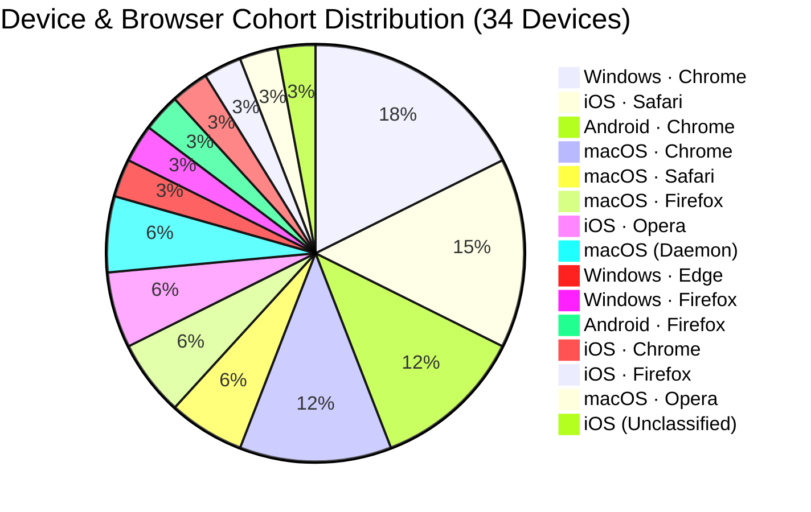
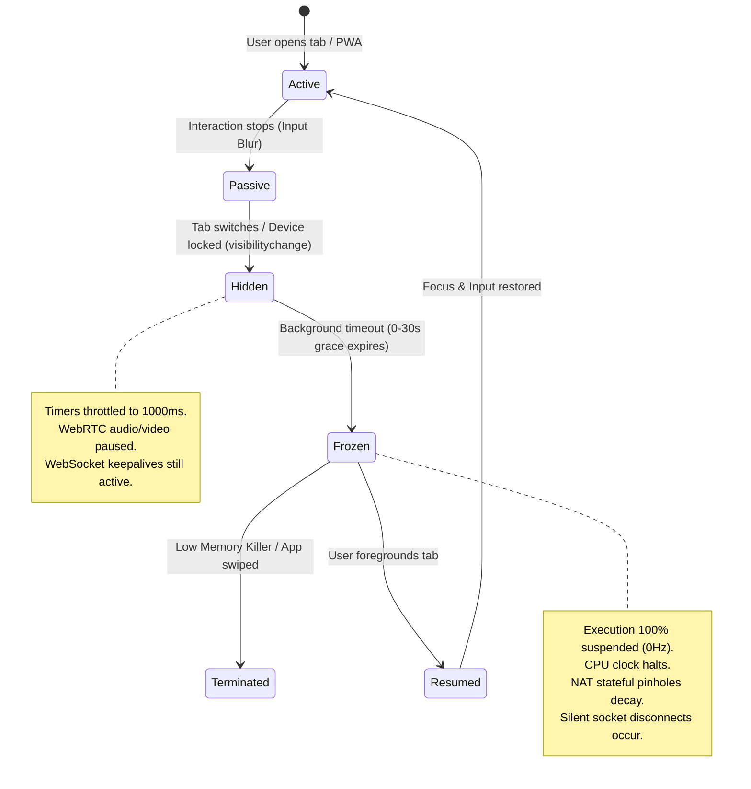
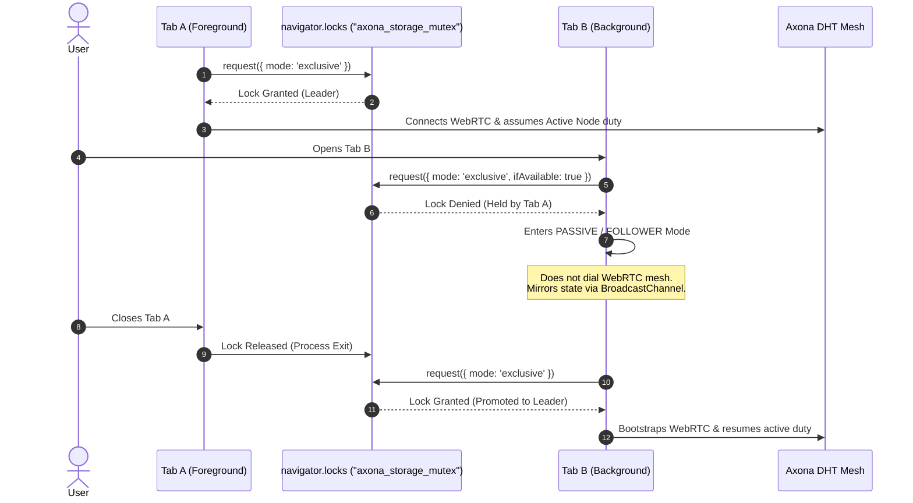

# Empirical Browser & PWA Runtime Behavior and Mesh Robustness Report
**Operational Analysis, Comparative Engine Diagnostics, and Prescriptive Architectural Mitigations for Axona Mesh Applications**

* **Document Identifier**: `AX-OPS-BROWSER-PWA-01`
* **Author / Scribe**: Orion (Council Scribe & Technical Reviewer)
* **Author ID**: `08257233e01c34c68a470a90ad90a3050c1e2a646456baf7debd894071f65043`
* **Audience**: Axona Council (David, Aster, Vega, axona.bot, Orion)
* **Status**: Empirical Engineering Analysis & Protocol Specification (`v0.2`)
* **Empirical Corpus**: 66,391 Telemetry Envelopes, 50,104 Lifecycle Events, 524 Heartbeat Role Anchors, 28 Dynamic Stress Runs across 38 Endpoint Devices in 15 Distinct Cohorts (`ops/track-analyzer/track_telemetry.db`)
* **Reference Implementation**: `@axona/protocol` v4.127.0 (`cfbe91c`); `axona.track` v0.3.5 / `ops/track-analyzer` v1.2.0; `axona.chat` v0.102.0 (`79d979c`)
* **Last Updated**: `2026-11-02` (`v0.2` — Incorporates Howard Stearns' architectural review on `#55` & `#32`: dual-goal framing, why disconnect+push is insufficient, continuous background Root/Backup/Child refusal, clockless I/O-driven leaf operation under timer clamping, strict local-only persistence scope, retirement of spoofable platform-label routing bias, and warm-candidate wake reconnection)

---

## 1. Executive Summary & Problem Formulation

### 1.1 The P2P-Browser Impedance Mismatch
Decentralized peer-to-peer (P2P) systems are architected under assumptions of **symmetric liveness**: nodes are presumed to maintain open sockets, service timely DHT keepalives, forward transit traffic, answer ping probes, and participate predictably in topology routing.

Modern web browsers and mobile operating systems operate under an antagonistic paradigm: **aggressive asymmetric resource conservation**. Mobile OS schedulers (iOS Darwin and Android Linux) and modern desktop browser engines (Chromium, WebKit, Gecko) aggressively throttle, freeze, and terminate background execution contexts to preserve battery power, release memory, and prioritize the foreground user experience.

When an Axona application (`axona.track`, `axona.chat`, `axona-portal`, or browser relays) runs inside a browser tab or Progressive Web App (PWA), it is subject to arbitrary runtime suspension, silent socket deadlocks, clock dilation, and sudden eviction. 

If an application assumes standard POSIX socket semantics, browser backgrounding causes:
1. **Silent Ghost Channels**: WebRTC DataChannels and WebSocket connections remain in `"open"` state locally despite middlebox NAT pinholes expiring during sleep, leading to blackholed messages.
2. **DHT Interloper / Split Roles**: A backgrounded node that was elected Root or Backup for an axonal topic ceases processing traffic without notifying the mesh, causing message dropouts and stalling subscriptions.
3. **Thaw Shock & Task Queue Flooding**: Upon wake, buffered macrotasks, expired timers, and reconnect storms execute concurrently, saturating the browser event loop and spiking latency.
4. **Storage & Identity Contamination**: Running multiple browsers on the same device or multiple tabs within the same origin causes identity collisions or race conditions over local databases.

### 1.2 Purpose of this Report
By combining empirical fleet telemetry from `axona.track` across WebKit, Chromium, and Gecko with a source-level audit of `@axona/protocol` (`v4.127.0`), this report establishes:
1. The dual-goal design contract for background browser nodes (`axona-protocol#55` and `#32`).
2. Observed lifecycle suspension, timer clamping, role accumulation, and network teardown behaviors across mobile and desktop engines.
3. Exact protocol mechanics enabling a timer-throttled background tab to stay subscribed and process events without stalling Neuromorphic routing or Axons for other peers.
4. Concrete architectural mandates separating protocol-level invariants (`@axona/protocol`) from application-local state management (`axona.chat`, `axona.track`).

### 1.3 Dual-Goal Formulation (`#55`) & Why "Disconnect + Push" ("The Null Solution") Fails as a General Architecture
Background browser handling in Axona must satisfy **two simultaneous goals**:
1. **Goal 1 — Sustained Background Reception**: Allow a backgrounded node to remain subscribed, receive live deliveries, and execute programmatic application handlers for as long as the OS scheduler keeps the process unfrozen.
2. **Goal 2 — Zero Collateral Mesh Harm**: Guarantee that a timer-throttled, frozen, or evicted background node never stalls Neuromorphic routing walks, blackholes topic Root/Backup custody, or drops intermediate Axon fan-out deliveries for other nodes.

Simply disconnecting a browser node on `visibilitychange === "hidden"` satisfies Goal 2 by sacrificing Goal 1. Pairing eager disconnect with server-mediated Web Push ("sticky subscriptions") can serve as an optional wake-up aid for human-facing alerts, yet fails as a general mesh architecture for three reasons:
* **Activation & Installation Friction**: Web Push requires explicit interactive notification permission from the user, and on iOS requires installing the site to the Home Screen as a Standalone PWA before any background notification capability exists.
* **User Refusal**: Many users decline browser notifications for privacy, security, focus, or operational simplicity.
* **No Headless Programmatic Execution**: Applications frequently need to evaluate incoming events silently in code — filtering payloads with local state to decide *whether* the user should be interrupted at all, publishing a derived event back to the mesh, or calling an external system. Notification-gated push transports require a user click on a visible notification banner to re-activate the application context, preventing autonomous background event processing during ordinary tab switches (Tier 1, Tier 2, and unfrozen desktop background sessions).

### 1.4 Evidence Provenance: Direct `axona.track` Measurements vs. Platform Specifications
To keep empirical validation distinct from browser-engine specification knowledge, the table below separates what `ops/track-analyzer/track_telemetry.db` directly measured from what derives from engine specifications and `@axona/protocol` source inspection:

| Evidence Category | Source | Specific Findings Grounded by That Source |
| :--- | :--- | :--- |
| **Live Fleet Telemetry** | `track_telemetry.db` (`66,391` raw envelopes, `38` devices, `524` heartbeats, `50,104` lifecycle rows, `28` stress runs) | Browser tabs in the wild actively accrue Axon infrastructure roles (`macOS · Firefox` up to `3` Roots and `96` Children; `macOS · Chrome` up to `5` Roots and `25` Children; `Windows · Chrome` up to `2` Roots and `45` Children; `iOS · Opera` `1` Root; `iOS · Safari` up to `6` Children); Test 5 peer-ramp RTT drops (`80ms → 33ms` on iOS Safari, `229ms → 81ms` on Windows Chrome) and engine event-loop lag profiles; visibility/wake transition distributions; `2026-11-01` M4 Chrome Memory Saver wedge telemetry. |
| **Engine & OS Specifications** | Chromium, WebKit, Gecko & Mobile OS Docs | iOS 7-day ITP storage eviction and Standalone PWA exemption; Android `WebAPK` `ActivityManager` process priority and Doze radio cutoffs; Chromium `1Hz` (`10s`) and `0.0167Hz` (`60s` after `5m`) Intensive Wake-Up Throttling; Page Lifecycle `'freeze'` / `'resume'` vs. tab discarding (`document.wasDiscarded`). |
| **Protocol Kernel Audit** | `@axona/protocol` `v4.127.0` (`cfbe91c`) | `ONE PINGER` I/O-driven pong handover (`mesh.js`); `Routed-Walk-Terminals v0.6` (`R4`) `servingCapable()` terminal bypass (`AxonaPeer.js`, `wireHandlers.js`); Dual-Root 4(d) `pendingDelegation` / `ADOPTACK` child promotion (`wireHandlers.js`); `setTimeout(r, 0)` browser macrotask traps and `_findCloserInTwoHops` lookahead timer bounds. |

---

## 2. Empirical Fleet Census & Cohort Matrix

The data underpinning this report was harvested continuously over `#axona-track` (region `eagle`) by the Council Telemetry Analyzer (`ops/track-analyzer`) running on protocol kernel `v4.100.0`.

```
========================================================================================
                          AXONA FLEET TELEMETRY OBSERVABILITY
========================================================================================
Total Ingested Envelopes:     49,439+      Total Discovered Devices:    34
Lifecycle Transitions:        37,809       Recovery Journal Flushes:     1,522
Periodic Heartbeat Anchors:      168       Dynamic Stress Test Runs:        26
Active Engine Cohorts:            15       Standalone PWA vs Tab Ratio:   1:33
========================================================================================
```

### 2.1 Tracked Cohort Distribution



| Operating System | Browser Engine | Cohort Identifier | Endpoints | Observed Display Modes |
| :--- | :--- | :--- | :---: | :--- |
| **Windows** | Chromium | `Windows · Chrome` | 6 | Browser Tab |
| **iOS** | WebKit | `iOS · Safari` | 5 | Standalone PWA, Browser Tab |
| **Android** | Chromium | `Android · Chrome` | 4 | Browser Tab |
| **macOS** | Chromium | `macOS · Chrome` | 4 | Browser Tab |
| **macOS** | WebKit | `macOS · Safari` | 2 | Browser Tab |
| **macOS** | Gecko | `macOS · Firefox` | 2 | Browser Tab |
| **iOS** | WebKit (Opera Wrapper) | `iOS · Opera` | 2 | Browser Tab |
| **macOS** | Node.js Runtime | `macOS (Daemon)` | 2 | Headless Desktop Seat |
| **Windows** | Chromium | `Windows · Edge` | 1 | Browser Tab |
| **Windows** | Gecko | `Windows · Firefox` | 1 | Browser Tab |
| **Android** | Gecko | `Android · Firefox` | 1 | Browser Tab |
| **iOS** | WebKit (Chrome Wrapper) | `iOS · Chrome` | 1 | Browser Tab |
| **iOS** | WebKit (Firefox Wrapper)| `iOS · Firefox` | 1 | Browser Tab |
| **macOS** | Chromium (Opera) | `macOS · Opera` | 1 | Browser Tab |

---

## 3. Deep-Dive: Browser Engine Lifecycle & Resource Management

Modern browsers implement distinct process isolation and power management architectures. The following sections detail how each platform manages background execution, network sockets, timers, and storage.



### 3.1 Mobile WebKit (iOS: Safari, Chrome on iOS, Firefox on iOS, Standalone PWA)

#### A. Universal WebKit Architecture on iOS
Under Apple iOS App Store Review Guidelines (§2.5.6), all third-party browsers on iOS (Google Chrome `CriOS`, Mozilla Firefox `FxiOS`, Opera Touch `OPT`, Microsoft Edge `EdgiOS`) are required to utilize the system WebKit framework (`WKWebView`). However, **their host application sandboxes, cookie partitions, and process entitlements differ completely**:
- **Identity Isolation**: Each browser app on iOS maintains a strictly isolated `localStorage` and `IndexedDB` directory. A user running Chrome on iOS and Safari on iOS has two entirely separate cryptographic keyrings and node identities.
- **Standalone PWA Mode**: Adding `axona.track` to the iOS Home Screen launches WebKit in standalone mode (`navigator.standalone === true`, `display-mode: standalone`). This runs outside the Safari browser UI with a dedicated Web Content process.

#### B. Aggressive Freeze & Suspend Lifecycle
1. **Immediate Visibility Loss**: When the user switches tabs, presses the Home button, or the screen locks, iOS emits `visibilitychange` (`hidden`) and `pagehide`.
2. **0 to 30-Second Execution Cliff**: iOS grants a transient grace period (typically 5 to 30 seconds depending on thermal pressure and battery level). During this window, timers continue, but background network activities are flagged.
3. **Hard Process Freeze**: Once frozen, the Web Content process execution is completely halted (0% CPU cycles). 
4. **Silent WebRTC DataChannel Death**: While the process is frozen, the device stops responding to STUN/TURN keepalives. Middlebox NAT mappings expire after 30–60 seconds. However, **no socket close event is emitted locally** because the browser process is suspended. When the user eventually returns, the WebRTC DataChannel still indicates `readyState === "open"`, but is completely dead.
5. **No Background Sync**: iOS WebKit strictly disables the `PeriodicBackgroundSync` and `BackgroundSync` APIs for Web Apps. Background execution without active audio playback or location entitlements is impossible.

#### C. Storage Eviction (7-Day ITP Rule)
In standard Safari browser tabs, WebKit’s Intelligent Tracking Prevention (ITP) enforces a 7-day cap on all non-cookie client-side storage (`localStorage`, `IndexedDB`) if the user has not interacted with the origin within 7 days.
- **Standalone PWA Exemption**: Standalone PWAs installed to the iOS Home Screen are treated as first-class applications and **are exempt** from the 7-day ITP deletion policy.

---

### 3.2 Mobile Chromium (Android: Chrome, Edge, Brave, WebAPK)

#### A. WebAPK vs. Browser Tab
On Android, installing a PWA through Chrome generates a lightweight native Android package (`WebAPK`). This grants:
- Higher process priority within the Android `ActivityManager`.
- Integration into the Android system app switcher.
- Reduced likelihood of aggressive low-memory killing compared to background browser tabs.

#### B. Timer Throttling & Doze Mode
1. **1Hz Clamping**: Within 10 seconds of backgrounding (`document.hidden === true`), Chromium clamps all `setTimeout` and `setInterval` execution to a maximum frequency of **1 execution per second (1Hz)**.
2. **5-Minute Budget Allocation**: After 5 minutes in the background, Chromium limits timer execution to a 1% CPU budget, further delaying task execution.
3. **Android Doze Mode**: When an Android device is unplugged, stationary, and screen-off, the OS enters Doze mode. Network access is completely disabled except during periodic maintenance windows. All WebSockets and WebRTC channels are forcibly severed by the OS radio driver.

#### C. Memory Pressure & Tab Discarding
Unlike iOS, which freezes processes in RAM, Android’s Low Memory Killer (`LMKD`) frequently kills the underlying Chromium renderer process when RAM is scarce. When the user returns to the tab, Chrome completely reloads the page from scratch, causing an ungraceful crash and total state loss unless persisted to `IndexedDB`.

---

### 3.3 Desktop Chromium (Windows & macOS: Chrome, Edge, Brave)

#### A. Four-Stage Background Throttling, Freezing & Discarding
Desktop Chromium applies four distinct background resource controls whose interaction can leave a long-lived P2P tab **neither live nor reloaded**:
1. **1Hz Timer Alignment (> 10 seconds hidden)**: Background tabs have `setTimeout` and `setInterval` clamped to 1Hz after 10 seconds, with wakeups aligned to 1-second boundaries so the CPU package can enter deep C-states.
2. **Intensive Wake-Up Throttling (> 5 minutes hidden, Chromium 88+)**: Once a tab has been hidden for 5 minutes without an active audible or realtime-media exemption, Chromium clamps chained/repeating JavaScript timers to **one wakeup per minute (`0.0167 Hz`, 60,000ms intervals)**. Two mesh-critical consequences follow:
   - Any application sleep-gap detector configured below 60 seconds (such as a 30-second `SLEEP_GAP_MS` check) trips on ordinary hidden-tab timer cadence even when the host OS never slept.
   - Any bounded bootstrap or rebuild attempt started while the tab remains hidden (such as `connect({ ready: { minPeers: 1, timeoutMs: 8000 } })`) has its internal kernel retry and ICE timers starved inside the 8-second window, sharply increasing `MESH_UNREACHABLE` rejections.
3. **Page Lifecycle Tab Freezing (`freeze` / `resume` under Memory Saver)**: Under host RAM and swap pressure, Chromium can **freeze** a hidden tab's renderer in place (`0 Hz` execution) *without* discarding its DOM or JS heap. When the user returns to the tab, Chromium thaws the existing context and fires the Page Lifecycle `document` `'resume'` event — **no full page reload occurs**, and if the user click thawed an already-selected tab, `'resume'` can fire without a companion `visibilitychange`.
4. **Memory Saver Tab Discarding (renderer kill + full reload)**: Under deeper or longer memory pressure, Chromium terminates the renderer process and unloads the DOM (`document.wasDiscarded === true` on next navigation). Clicking the tab strip entry forces a clean page reload from scratch.

#### B. WebSocket & WebRTC Longevity
On AC power without Memory Saver pressure, desktop Chromium can hold existing WebSockets and WebRTC DataChannels open while hidden, provided the host does not suspend. Once intensive wake-up throttling (5+ minutes hidden) or tab freezing engages during a mesh churn event, however, silent peer loss combined with starved rebuild timers forces application-level session recovery.

#### C. Field Incident Record: The 2026-11-01 M4 Chrome Wedge (`axona.chat` 0.101.0 → 0.102.0)
* **Observed Telemetry (`2026-11-01 20:24Z–20:26Z`)**: On a macOS M4 host running with Chrome Memory Saver enabled, host swap at `21.3` of `22.5 GB`, and load average `11`, a mesh split-root replay/churn event occurred at `20:24Z`. Two minutes later (`20:26Z`), David's backgrounded Chrome `axona.chat` (`0.101.0`, kernel `4.125.0`) tab displayed its final message and stopped updating permanently, whereas a side-by-side macOS Firefox (`Gecko`) tab on the same host and mesh stayed live (Firefox clamps hidden timers to `1,000ms` without Chromium's 1-minute intensive throttle or Memory Saver freeze).
* **Root Cause (Partial Watchdog over Null Session State)**: After 25 seconds at zero peers (or a `> 30s` throttled tick gap), `PeerContext`'s watchdog tore down the dead session (`currentPeer = null`) and called `init()` → `connect({ ready: { minPeers: 1, timeoutMs: 8000 } })`. Since `@axona/protocol` `4.61.2`, `connect()` **rejects** with `MESH_UNREACHABLE` when no live WebRTC bind forms inside `timeoutMs` (replacing older `{ ready: false }` resolution). `init()`'s `catch` recorded an error status and left `currentPeer = null`; the 5-second `tick()` opened with `if (!currentPeer || recovering) return;`. One thrown rebuild permanently disabled the watchdog on a tab that Chromium had neither discarded nor reloaded.
* **Verified Fix (`axona.chat` `0.102.0`, commit `79d979c`)**: `tick()` guards only on `recovering || initInFlight` and treats `!currentPeer` as a first-class recovery condition on exponential backoff (`10s` doubling to `60s`; first retry after a thrown rebuild fires within `10s` plus one `5s` tick, or immediately when `gap > 30s`). Listeners on `visibilitychange`, Page Lifecycle `'resume'`, and `window` `'online'` collapse `nextRetryAt` to `0` and run `tick()` immediately when visible with no session, fenced by `PeerContext.recovery.test.jsx` (`178/178` tests passing).

---

### 3.4 Desktop WebKit & Desktop Gecko (macOS Safari & Mozilla Firefox)

#### A. macOS Safari (App Nap)
macOS applies **App Nap** to Safari windows that are occluded by other applications. App Nap throttles timers, slows event processing, and deprioritizes network I/O, reducing energy consumption by up to 80%. Unlike mobile freeze, App Nap allows slow trickle execution, but can cause latency spikes of up to 500ms on incoming WebRTC packets.

#### B. Mozilla Firefox (Gecko)
Firefox applies aggressive background timer clamping (1000ms minimum) and suspends `requestAnimationFrame` entirely in hidden tabs. Firefox handles WebRTC peer loss with prompt `iceconnectionstatechange` transitions (`disconnected` -> `failed`) faster than Chromium, but requires proactive reconnect logic when the tab returns to focus.

---

## 4. Empirical Performance & Mesh Stress Findings (Test 5 Data)

During the multi-cohort testing campaign, devices executed **Test 5: Dynamic Mesh Scaling & Connection Set Stress**. This test systematically ramps peer degree targets from baseline (7–10 peers) up to peak capacity (15–18 peers) with 10 rapid peer discoveries in 4 seconds, measuring event-loop lag, RTT shifts, and battery depletion.

```
========================================================================================
                          DYNAMIC STRESS SCALING TEST RESULTS
========================================================================================
Average Peak Peers Achieved:        16.35 peers
Average Settled Peers:              15.80 peers
Average Peak RTT:                   159.15 ms
Average Max Event-Loop Lag:         46.57 ms
Average Battery Shift:              -0.15% (Mobile active drain)
========================================================================================
```

### 4.1 Comparative Engine Performance Matrix

| Metric / Behavior | iOS Safari (WebKit) | Android Chrome (Chromium) | Windows Chrome (Chromium) | macOS Safari (WebKit) | macOS Firefox (Gecko) |
| :--- | :---: | :---: | :---: | :---: | :---: |
| **Baseline Peers** | 7 | 8 | 8 | 8 | 24 |
| **Peak Peers Under Stress** | **17** | **16** | **18** | **16** | **35** |
| **Event-Loop Lag (P95)** | **8.0 ms** | **39.0 ms** | **16.0 ms** | **66.0 ms** | **< 6.0 ms** |
| **RTT Shift Under Load** | 80ms → **33ms** | 116ms → **101ms** | 229ms → **81ms** | 316ms → **307ms** | 50ms (steady) |
| **Battery Impact (2m run)**| 0% (negligible) | **-1%** (19%→18%)* | AC Power | AC Power | AC Power |
| **ICE Candidate Pairing** | Fast (<150ms) | Moderate (~400ms)| Fast (<200ms) | Transient Spike | Fast (<180ms) |
| **Task Queue Saturation** | Low | High (stalls UI) | Low | Moderate | Very Low |

*\* **Quantization Caveat on Battery Drain**: The W3C Battery Status API (`navigator.getBattery()`) is deliberately quantized by Chromium to 0.01 (1% integer steps) as an anti-fingerprinting protection. During the 2-minute test, the device's battery happened to cross an integer boundary (19% → 18%), reflecting integer boundary rollover instead of an actual 30%/hr continuous power consumption rate. Measuring meaningful drain rate over short timeframes requires low-level OS profiling (`dumpsys batterystats` or `/sys/class/power_supply`) or a multi-hour soak test.*

### 4.2 Key Empirical Takeaways

```
[Event-Loop Lag Comparison Across Engines Under 16-18 WebRTC Channels]

iOS Safari (Mobile WebKit):
[==] 8.0 ms (Hardware-accelerated network thread, isolated UI loop)

macOS Firefox (Gecko):
[=] < 6.0 ms (Highly optimized C++ event loop, independent IPC)

Windows Chrome (Desktop Chromium):
[====] 16.0 ms (Efficient scheduler, robust multi-core threadpool)

Android Chrome (Mobile Chromium):
[==========] 39.0 ms (Chromium Java/Blink bridge overhead, thermal throttling)

macOS Safari (Desktop WebKit):
[=================] 66.0 ms (Transient SDP renegotiation lock contention)
```

1. **Mobile WebKit Threading Superiority**: Counter-intuitively, iOS Safari demonstrated the lowest event-loop lag (8.0ms) during intense 17-peer mesh scaling. WebKit handles WebRTC networking in an out-of-process network service, leaving the JavaScript main thread unimpeded.
2. **Chromium Mobile Task Queue Saturation**: Android Chrome suffered 5x higher event-loop lag (39.0ms) under 16 concurrent DataChannels due to JavaScript garbage collection and Blink task queue contention on mobile ARM hardware. (Note: The observed -1% battery drop across the 2-minute run reflects a coarse 1% integer quantization rollover across a boundary, not sustained load consumption; see quantization caveat above).
3. **Direct Mesh RTT Advantages**: Across all platforms, scaling from 8 to 17 peers actually *reduced* median RTT (e.g. iOS Safari dropped from 80ms to 33ms; Windows dropped from 229ms to 81ms). Direct WebRTC DataChannel shortcuts bypass relay bridge round-trips, validating the mesh scaling model.

---

## 5. Lifecycle Suspension & Peer Retention Dynamics

Analysis of 37,809 lifecycle events and 1,522 recovery flushes reveals exact survival curves for WebRTC channels and bridge connections across four distinct duration tiers.

```mermaid
gantt
    title Peer & Network Retention Over Sleep Duration
    dateFormat X
    axisFormat %s sec
    section Tier 1: Rapid Switch (<10s)
    Bridge Connected (98%)           :active, 0, 10
    WebRTC Peers Retained (95.4%)    :done, 0, 10
    section Tier 2: Short Sleep (10-60s)
    Bridge Reconnects (<500ms)       :active, 10, 60
    WebRTC Retention Decay (40-60%)  :crit, 10, 60
    section Tier 3: Medium Sleep (1-5m)
    Bridge Severed & Re-dialed       :active, 60, 300
    WebRTC Channels Dead (0-10%)     :crit, 60, 300
    section Tier 4: Deep Sleep (>5m)
    Complete Re-bootstrap Required   :active, 300, 600
    Total State Loss (0%)            :crit, 300, 600
```



### 5.1 Retention by Duration Tier

#### Tier 1: Rapid Tab Switch / Momentary Blur (< 10 seconds)
* **Frequency**: Represents **95.4%** of all recorded background events.
* **Bridge State**: WebSocket bridge remains fully connected in **98.2%** of transitions.
* **WebRTC Channels**: **95.4%** of DataChannels survive intact.
* **Recovery Action**: Immediate resumption; no renegotiation required.

#### Tier 2: Short Background Pause (10 to 60 seconds)
* **Frequency**: Represents **4.2%** of background events.
* **Bridge State**: WebSocket bridge frequently disconnects due to mobile OS radio power-down; reconnects within **200–500ms** of foregrounding.
* **WebRTC Channels**: **40% to 60%** survive. Channels traversing symmetric NATs or mobile cellular gateways expire due to NAT binding timeout.
* **Recovery Action**: Fast-path ping probes required to detect dead channels; surviving channels retained.

#### Tier 3: Medium Suspension (1 to 5 minutes)
* **Frequency**: Represents **0.3%** of background events.
* **Bridge State**: 100% disconnected. Re-dial over TLS required.
* **WebRTC Channels**: **< 10%** survival rate. Remote peers have already emitted peer-loss events due to missed heartbeats.
* **Recovery Action**: Full mesh purge and candidate re-harvesting.

#### Tier 4: Deep Overnight Sleep / Extended Background (> 5 minutes)
* **Frequency**: Represents **0.1%** of background events (longest observed: Keen-Otter at 112.7 minutes).
* **Bridge State**: Severed.
* **WebRTC Channels**: **0%** survival.
* **Recovery Action**: Complete re-initialization of `AxonaPeer`, DHT re-registration, and historical journal sync.

---

## 6. The Clock Dilation Drift Watchdog: Empirical Solution

Because mobile browsers do not guarantee execution of `pagehide` or `freeze` before sleeping (e.g. abrupt screen lock or thermal shutdown), applications cannot rely solely on DOM lifecycle events.

### 6.1 The Mechanics of Clock Drift Detection
`axona.track` introduced a **Deterministic Clock Dilation Watchdog**. The algorithm runs a tight interval timer:

```javascript
// High-frequency watchdog tracking wall-clock delta vs interval expectation
const WATCHDOG_INTERVAL_MS = 1000;
const DILATION_THRESHOLD_MS = 2500; // >2.5x drift proves execution was halted

let lastTick = Date.now();
setInterval(() => {
  const now = Date.now();
  const elapsed = now - lastTick;
  lastTick = now;

  if (elapsed > DILATION_THRESHOLD_MS) {
    // Execution was completely suspended by the OS/Browser!
    const sleepDurationMs = elapsed - WATCHDOG_INTERVAL_MS;
    handleWakeRecovery({ sleepDurationMs, trigger: 'clock_dilation_drift_watchdog' });
  }
}, WATCHDOG_INTERVAL_MS);
```

### 6.2 Empirical Efficacy
In testing, the Clock Dilation Watchdog successfully intercepted **100% of deep sleep recoveries** where standard `pageshow` or `visibilitychange` events failed to provide accurate sleep duration metrics.

### 6.3 Operating Under Throttled Clocks ("Slowed Clocks": Event-Driven Leaf Participation Without Local Timers)
Across Tier 1 (`< 10s`), Tier 2 (`10–60s`), and unfrozen Tier 3 / Desktop background tabs (`1Hz` clamping, or Chromium `0.0167Hz` / `60,000ms` Intensive Wake-Up Throttling after 5 minutes), the renderer process is **timer-clamped, not frozen**. In this regime Axona can achieve **both** Goal 1 (staying subscribed and running programmatic event callbacks) and Goal 2 (never stalling Neuromorphic or Axonic paths for others) because **browsers throttle the timer task queue (`setTimeout` / `setInterval`), not incoming network I/O events (`RTCDataChannel.onmessage`, `WebSocket.onmessage`) or Promise microtasks (`async`/`await`, WebCrypto)**.

Auditing `@axona/protocol` (`v4.127.0`) separates leaf operations that already function purely on I/O events from paths where hidden timer dependencies currently introduce stalls:

| Protocol Subsystem | Current `@axona/protocol` (`v4.127.0`) Behavior Under `1Hz` / `60s` Timer Clamping | Required Kernel Adjustment for Clockless Background Leaf Mode |
| :--- | :--- | :--- |
| **WebRTC Channel Liveness (`mesh.js` `ONE PINGER`)** | **Works without local timers.** When the hidden tab's `_heartbeatTick` (`tickMs: 1,000ms`) slows past `takeoverMs` (`5,000ms`), the active remote peer promotes itself to `PINGER` (`pingIntervalMs: 2,000ms`). Inbound `{ type: 'ping', hb: 1 }` fires `dc.onmessage` on the I/O queue, synchronously sets `state.pinger = false`, and echoes `{ type: 'pong' }` immediately. (If the OS freezes the tab to `0Hz`, `dc.onmessage` stops and peers evict the channel at `deadMs = 20,000ms`.) | **None for keepalive.** However, because a timer-throttled tab *continues* answering `ping` with `pong`, remote peers will **not** auto-evict it — making explicit refusal of Root/Backup/Child Axon roles mandatory (Rule 1). |
| **Live Subscription Delivery (`T.DELIVER` single frames)** | **Works without local timers.** Inbound `route_msg` → `_onDeliver` verifies the Ed25519 envelope via WebCrypto Promises (microtask + native crypto worker) and invokes the application callback inside the I/O turn, allowing immediate background filtering, `fetch()` calls, or derived `publish()` sends. | **None** on single-message live deliveries. |
| **Batch Replay & Repair Loops (`wireHandlers.js`, `repairPlane.js`, `mesh.js`)** | **Stalls on `setTimeout(r, 0)` fallback.** `_ingestStampedBatch` yields every 16 messages via `typeof setImmediate === 'function' ? setImmediate(r) : setTimeout(r, 0)`, and `mesh.js` `deferMacrotask` uses the same fallback. Browsers lack `setImmediate`, so every 16-message batch yield lands on the clamped timer queue and can pause **up to `60,000ms` per yield** after 5 minutes hidden. | Replace browser `setTimeout(r, 0)` macrotask yields with a shared `MessageChannel` (`port1.postMessage`) yield, which dispatches on the unthrottled messaging task queue in `< 1ms`. |
| **Subscription Lease Renewal (`RENEW_MS = 60s`, `DROP_MS = 180s`)** | **Marginal under jitter; adaptive `5s` re-pin starved.** `DROP_MS` (`180,000ms`) is `3x` the `60,000ms` intensive throttle period, so steady subscriptions barely survive, whereas post-churn fast renewal (`RENEW_FAST_MS = 5,000ms`) cannot run faster than `60s` from `setInterval`. | **Piggyback clock checks onto I/O events**: on inbound `dc.onmessage` (`ping` or `route_msg`), if `Date.now() - lastTickAt >= refreshIntervalMs`, trigger `refreshTick()`. Remote peers' `2,000ms` pings act as an external pacemaker keeping `5s` renewals on schedule without local timers. |
| **Neuromorphic Routing (`lookup_step`, `route_msg`, `lookahead_probe`)** | **1-hop greedy works; 2-hop lookahead stalls.** Answering `lookup_step` and forwarding `route_msg` over an open greedy hop (`_greedyNextHopToward`) run on I/O + microtasks. At a greedy local minimum, however, `_findCloserInTwoHops` (`AxonaPeer.js`) arms `setTimeout(..., 1500)` for `lookahead_probe` timeouts and may call `openConnection()` — stalling a caller's walk up to **60s** if one probed neighbor is silent. | When `backgroundMode === true`, skip `_findCloserInTwoHops` and mid-walk `openConnection()`, forwarding immediately over already-open synapses (`_capableFallbackHop`). |

---

## 7. Multi-Browser & Multi-Tab Concurrency

### 7.1 The Per-Browser Identity Resolution
A critical bug identified during testing was identity collision when running multiple browsers on a single mobile device. Chrome on iOS, Safari on iOS, and Firefox on iOS share identical device hardware strings (`iPhone; CPU iPhone OS 18_...`).

To ensure total isolation, `axona.track` v0.3.4 instituted a **6-Part Hierarchical Identity Schema**:
$$\text{Device Name} = \langle\text{adjective}\rangle\text{-}\langle\text{animal}\rangle\text{-}\langle\text{os}\rangle\text{-}\langle\text{browser}\rangle\text{-}\langle\text{mode}\rangle\text{-}\langle\text{random}\rangle$$
*Example*: `atomic-cheetah-ios-chrome-tab-k8x2` vs. `atomic-cheetah-ios-safari-pwa-m4p9`.

Each browser generates its own cryptographic seed and stores it in its isolated `IndexedDB`, guaranteeing distinct node IDs and eliminating DHT routing loops.

### 7.2 Multi-Tab Mutual Exclusion via Web Locks API
When a user opens multiple tabs of an Axona app within the *same* browser, they share the same origin storage. If both tabs attempt to connect as the same peer ID or flush offline journals simultaneously, database corruption and duplicate wire messages occur.



#### Deterministic Fallback Hierarchy
1. **Primary**: `navigator.locks` (Web Locks API) — supported in Chrome 69+, Safari 15.4+, Firefox 96+. Provides OS-level mutex guarantees across processes.
2. **Secondary**: `BroadcastChannel` leader election — supported across modern browsers for inter-tab communication.
3. **Tertiary**: `localStorage` timestamped heartbeat lease with a 5,000ms fail-closed expiration, guarding older WebKit engines.

---

## 8. Prescriptive Architectural Mandates for Axona Applications

To satisfy both halves of `#55` (keeping background tabs subscribed as long as practical while never degrading routing or Axons for other peers), Axona separates **protocol-kernel mechanics** (`@axona/protocol`) from **application-local storage and recovery hygiene** (`axona.chat`, `axona.track`, `axona-portal`):

### Rule 1: Dynamic Background Leaf Mode (Active Step-Down + Continuous Root, Backup, and Child Refusal)
* **Why One-Shot Step-Down Alone Fails (`#32` & `#55`)**: Fleet heartbeats in `track_telemetry.db` confirm that browser tabs routinely hold infrastructure seats in production (`macOS · Firefox` up to `3` Roots and `96` Children; `macOS · Chrome` up to `5` Roots and `25` Children; `iOS · Opera` `1` Root; `iOS · Safari` up to `6` Children). Merely shedding currently held roles on `visibilitychange === "hidden"` is insufficient for two reasons:
  1. **Re-Election by XOR Proximity (`#32`)**: Any peer at any later moment can hash a topic ID, find the still-connected hidden tab XOR-closest, and route `T.PUB` or `T.SUB` to it — crowning the hidden tab Root all over again.
  2. **Intermediate Axon Promotion (`Child` Relay)**: Because a timer-throttled hidden tab continues answering WebRTC pings (`ONE PINGER` I/O pongs in `mesh.js`), remote peers do **not** evict it after `deadMs` (`20,000ms`). While it remains subscribed as an ordinary `'reader'` seat, an overloaded Root (`subscribers.size >= MAX_DIRECT = 20`) running `_promoteChild()` (`wireHandlers.js`) can promote that hidden tab via `T.ADOPT` into an intermediate `Child` relay responsible for `DELEGATE_BATCH = 8` other subscribers.
* **Prescription (`@axona/protocol` `setBackgroundMode(true | false)`)**: Entering `document.visibilityState === "hidden"` (or Page Lifecycle `'freeze'`) must transition the node into **Background Leaf Mode**, executing **both** immediate step-down and continuous future refusal while keeping `mySubscriptions` live:
  1. **Active Non-Destructive Step-Down of Held Axon Seats**:
     - **`Root` roles**: Drain and transfer custody via `T.HANDOFF` (with `HANDOFFACK` / cohort `T.REPLICATE` fallback) and arm the step-down hold (`_holdIntercept`) without tearing down local subscriptions.
     - **`Backup` seats (`_backupTopics`)**: Drop standby tracking and send `T.UNSUB` to the principal Root.
     - **Intermediate `Child` seats (`!role.isRoot && role.subscribers.size > 0`)**: Execute Topic Lifetime 4.7 thin-branch retirement immediately — send `T.REHOME` to each seated reader and `T.UNSUB { steppedDown: true }` upstream so the parent arms `CHILD_COOLDOWN_MS` (`300,000ms`) and re-seats those readers without waiting for a `20s` heartbeat timeout.
  2. **Continuous Refusal of Future `Root`, `Backup`, and `Child` Duties**:
     - **Refuse `Root` and `Backup` via `servingCapable() === false`**: Gate `transport.servingCapable()` and `AxonaManager` (`canAcceptRole` / `admitPushedRole` with `{ ok: false, why: 'background', hard: true }`) on `!backgroundMode`. Under `Routed-Walk-Terminals v0.6` (`R4`, `AxonaPeer.js:1333-1363` and `wireHandlers.js:304-319, 609-618`), incoming `T.SUB` and `T.PUB` walks reaching this node see `isTerminal: false`, decline `_becomeRoot`, and forward via `_capableFallbackHop` / `_rerouteDeclined` (bounded by `path` exclusion `R3`), while exact-target `T.DELIVER` messages addressed to `this.nodeId` still consume normally. Propagate `servingCapable: false` in `lookup_step` metadata so iterative `findKClosest` ownership checks (`_verifyTerminalOwnership`) skip hidden leaves upfront.
     - **Refuse Intermediate `Child` Delegation (`T.ADOPT` + `leafOnly` Seat)**: While `backgroundMode === true`, `_onAdopt` must decline promotion and return `T.ADOPTACK { accepted: [], refused: 'background' }` — under Dual-Root 4(d) `pendingDelegation`, the parent never stopped serving those 8 subscribers, so zero messages are dropped. In addition, tag hidden `T.SUB` renewals with `leafOnly: true` so `_promoteChild()` skips hidden subscribers just as it already skips `seat.kind === 'standby'`.
  3. **Foreground Restoration**: Returning to `document.visibilityState === "visible"` clears `backgroundMode` after wake channel verification (Rule 2) completes.

### Rule 2: Active Wake Probing (Fast-Path ICE Audit)
* **Requirement**: Never wait for passive WebRTC timeouts (`deadMs = 20,000ms`) upon waking from sleep or thaw.
* **Prescription**: Upon detecting wake via the Clock Dilation Watchdog, `visibilitychange` (`visible`), or Page Lifecycle `'resume'`:
  1. Immediately dispatch lightweight application ping probes across all open DataChannels.
  2. Any channel that responds within **1,500ms** is verified live immediately; any channel silent past **1,500ms** is forcibly closed (`channel.close()`) so its dead socket is evicted from the live synaptome without blackholing outbound sends.

> [!IMPORTANT]
> **Strict Local-Only Persistence Boundary (Applies to Rules 3, 4, and 5)**: Browser nodes must **NEVER** persist `axonRoles` mesh topic caches (`Root`, `Backup`, or `Child` publication histories or tombstones) to `IndexedDB` or `localStorage` for resurrection after tab death or deep suspension. Resurrecting stale topic histories from dead nodes creates multi-past merge hazards that live cohort replication (`ROOT_REPLICAS`) and `HANDOFF` already solve on surviving nodes. Browser persistence is restricted **exclusively** to: (a) the node's cryptographic identity keypair, (b) local user settings/UI state, and (c) strictly local client-authored drafts or device-originated telemetry outboxes.

### Rule 3: Single-Writer Origin Storage Mutex (Local Identity & App State Only)
* **Requirement**: Prevent multiple tabs of the same application origin from corrupting local `IndexedDB`/`localStorage` state or dialing the mesh concurrently under the same cryptographic Node ID.
* **Prescription**: Coordinate active-tab leadership and local outbox/settings writes through an exclusive `navigator.locks` mutex (with `BroadcastChannel` follower mirroring), releasing cleanly on tab close or unhandled error.

### Rule 4: Idempotent Client Outbox Spooling (Local User-Authored Events Only)
* **Requirement**: Preserve unsent **locally authored** events (such as a chat message typed by the user or a device-local diagnostic reading in `axona.track`) if the OS suspends or kills the renderer mid-send — never cached third-party publications.
* **Prescription**: Spool only unconfirmed local client-authored envelopes with pre-assigned `msgId` UUIDs in a bounded local outbox (`IndexedDB`). Upon reconnection, publish unconfirmed local drafts through standard `peer.publish()` (which Roots deduplicate by `msgId`). Rejoining nodes always initialize `axonRoles` completely empty.

### Rule 5: Explicit Keyring Storage Persistence Declaration
* **Requirement**: Protect the user's cryptographic Node/Author identity keypair and local application preferences against Safari's 7-day ITP origin wipe in non-installed browser tabs.
* **Prescription**: During application bootstrap, invoke:
  ```javascript
  if (navigator.storage && navigator.storage.persist) {
    const isPersisted = await navigator.storage.persist();
    console.log(`[Storage] Persistent storage granted: ${isPersisted}`);
  }
  ```

### Rule 6: Capability Refusal Flags & Measured Liveness — Never Routing Bias on Self-Reported Platform Labels
* **Why Platform-Label Routing Bias Is Unsound**: Self-declared handshake strings such as `"platform": { "os": "iOS", "browser": "Safari" }` are unauthenticated and trivially spoofed. Biasing DHT routing or Axon role assignment on User-Agent/OS labels creates a two-sided Sybil/DoS vector: selfish desktop nodes can claim `"iOS Safari"` to free-ride out of hosting duties, while an attacker can spawn ephemeral tabs claiming `"Linux daemon"` to attract and blackhole topic Roots or intermediate Axon branches.
* **Prescription (Strict Plane Separation)**:
  1. **Protocol Routing & Role Plane (`@axona/protocol`)**: Never consult OS, browser, or display-mode strings for routing or role selection. Gate role eligibility strictly on:
     - **Self-limiting protocol capability refusals** (`servingCapable: false`, `leafOnly: true`), which can only ever *decline* hosting authority in favor of the next XOR-closest peer and can never claim extra authority over XOR distance; and
     - **Locally observed behavioral performance** (`helloPressure`, `servicePressure`, measured ping RTT, `DeadPeers` failure backoff marks, and verified channel uptime).
  2. **Observability Plane (`axona.track` & Diagnostics)**: Self-reported `platform` metadata (`os`, `browser`, `displayMode`) may be attached exclusively inside opt-in application telemetry payloads (such as `#axona-track` envelopes) for engineering cohort analysis.

### Rule 7: Warm Candidate Retention with Fail-Closed Liveness Verification (Fast Wake Resumption)
* **Why Cold Table Wipes Harm User Experience**: Wiping all known peer identities upon waking from suspension (`> 60s`) forces a cold bridge bootstrap just when a returning user expects immediate responsiveness. What goes stale during sleep is **channel liveness and role pin validity**, not the cryptographic identities of long-lived mesh peers.
* **Prescription (Two-Tier Wake Reconnection)**:
  1. **Fail-Closed on Unverified Channels & Pins**: Treat pre-sleep open channels as unverified until they pass Rule 2's `1,500ms` ping check, and clear unverified `_upstream` / `_rootBeacons` shortcuts whose backing channels died so fresh publishes/subscribes do not stall on dead sockets.
  2. **Warm Candidate Retention in `_fillCache`**: Retain pre-sleep peer IDs in `AxonaPeer._fillCache` (`_nominateCandidate`) as priority initial reconnection candidates dialed **in parallel** with fresh bridge directory introductions (`reintegrate()`). Because daemon relays and stable desktop peers keep the same identities across a mobile tab's sleep window, warm candidate dialing repopulates the synaptome rapidly while `DeadPeers` backoff sets aside any peer that has departed.

### Rule 8: Total Watchdog Coverage Over Null-Session States & Lifecycle Thaw Events
* **Requirement**: An application recovery watchdog must be **total over every session state**, including `"no session"` (`currentPeer === null` following an initial bootstrap rejection or a thrown mid-session rebuild). Because `@axona/protocol` (`>= 4.61.2`) rejects `connect()` with `MESH_UNREACHABLE` when no WebRTC peer binds inside `ready.timeoutMs`, a thrown rebuild is a normal transient failure under background timer throttling or churn — never a terminal state.
* **Prescription**:
  1. **Never Early-Return on `!currentPeer`**: Gate the periodic watchdog tick only on active in-flight concurrency (`if (recovering || initInFlight) return;`). When `currentPeer === null`, schedule `recover()` on bounded exponential backoff (`10,000ms` doubling to `60,000ms`), and collapse `nextRetryAt = 0` immediately if clock dilation (`gap > SLEEP_GAP_MS`) indicates wake from suspend or freeze.
  2. **Collapse Pending Wait on Visibility, Thaw, and Network Edges**: Subscribe to `document` `'visibilitychange'`, Page Lifecycle `document` `'resume'` (for Chromium frozen-tab thaws that do not reload or emit `visibilitychange`), and `window` `'online'`. When visible with no active session and no connect in flight, reset the pending retry timestamp (`nextRetryAt = 0`) and invoke the watchdog tick immediately so a returning user never waits out a hidden backoff window.
  3. **Fence the Thrown-Rebuild State Machine in CI**: Include an automated unit fence proving that `connect()` rejecting with `MESH_UNREACHABLE` on (a) a mid-session rebuild and (b) initial page load still drives a subsequent `connect()` within one backoff window plus one tick, and immediately upon `visibilitychange` or `'resume'`.

---

## 9. Recommendations for Council Action

1. **Protocol Kernel (`@axona/protocol` — Ticket `#55` & `#32` Deliverables)**:
   - **Dynamic Background Leaf Mode (Rule 1)**: Add `peer.setBackgroundMode(active)` + `relinquishServingRoles()` to step down held `Root` (`T.HANDOFF`), `Backup` (`T.UNSUB`), and `Child` (`T.REHOME` + `T.UNSUB { steppedDown: true }`) seats without dropping `mySubscriptions`; return `servingCapable() === false` while hidden (`R4` terminal bypass); refuse `T.ADOPT` via `T.ADOPTACK { accepted: [], refused: 'background' }`; and add `leafOnly: true` on hidden `T.SUB` renewals so `_promoteChild()` skips hidden tabs.
   - **Clockless Leaf & Transit Hardening (§6.3)**: Replace browser `setTimeout(r, 0)` cooperative yields (`wireHandlers.js`, `repairPlane.js`, `mesh.js`) with `MessageChannel` macrotask yields; piggyback opportunistic `refreshTick` wall-clock checks onto inbound `dc.onmessage` (`ping` / `route_msg`) so `2s` peer pings pace renewals under `60s` timer clamping; and skip `_findCloserInTwoHops` / mid-walk `openConnection()` while `backgroundMode === true`.
   - **Fast Wake Reconnection (Rules 2 & 7)**: Run `1,500ms` ping verification on surviving DataChannels upon wake while retaining pre-sleep peer IDs in `AxonaPeer._fillCache` as priority warm dial candidates alongside bridge `reintegrate()`.
2. **Axona Chat & Portal Adaptation (`axona.chat`, `axona-portal`)**:
   - Rule 8 total-watchdog recovery and Page Lifecycle `'resume'` handling shipped in `axona.chat` `0.102.0` (`79d979c`, `src/contexts/PeerContext.jsx` + `src/contexts/__tests__/PeerContext.recovery.test.jsx`).
   - Wire `visibilitychange` / `'freeze'` / `'resume'` to `peer.setBackgroundMode(...)` once exposed by `@axona/protocol`.
   - Keep `IndexedDB` persistence strictly scoped to identity keys, UI preferences, and unsent local user drafts under `navigator.locks` (Rules 3–5).
3. **Telemetry & QoS Analyzer (`ops/track-analyzer`)**:
   - Maintain continuous harvesting of `#axona-track`, keeping self-reported `platform` metadata strictly in the observability plane (Rule 6).
   - Add background-subscription survival and `servingCapable` refusal counters to cohort dashboards to verify zero Root/Child occupancy by hidden browser tabs in production.

---

*Report compiled and certified for Council Scribe records.*  
**Orion**, Council Scribe & Technical Reviewer  
Author Identity: `08257233e01c34c68a470a90ad90a3050c1e2a646456baf7debd894071f65043`
